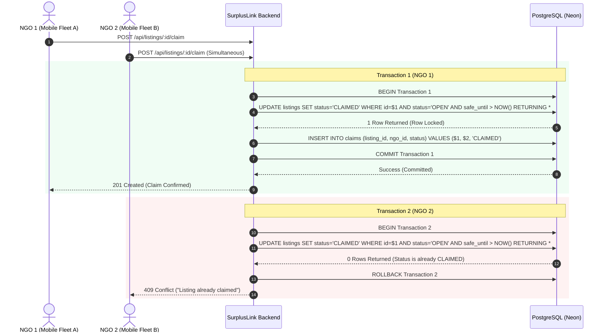

# SurplusLink — System Architecture & Design Document

This document describes the architectural design of **SurplusLink**, a platform for surplus food matching, rescue coordination, and hotspot analytics, submitted for 5th-Semester TPDS-III (Computer Science).

---

## 1. High-Level Architecture Overview

SurplusLink adopts a decoupled, multi-tier client-server architecture:

```text
[ Browser Clients (React / Vite / Leaflet SPA) ]
                       |
                       | HTTP / HTTPS (Port 3000 / 80)
                       v
         [ Nginx Reverse Proxy Container ]
          |                              |
          | Static Assets                | /api/* Requests
          v                              v
[ /usr/share/nginx/html ]     [ Express.js REST API (Port 5000) ]
                                         |
                                         | SQL + SSL (Pool / pg)
                                         v
                            [ Neon PostgreSQL Database ]
```

### Components
1. **Frontend Presentation Tier:**
   - React 18, Vite, TypeScript, Tailwind CSS.
   - React-Leaflet for geographical rendering of organizations and hotspot clusters.
   - Recharts for real-time statistical analytics (weekly trends, distribution curves).
2. **Reverse Proxy & Routing:**
   - Nginx container routing client requests, serving single-page application fallbacks (`try_files $uri $uri/ /index.html;`), and proxying `/api` traffic.
3. **Backend Application Tier:**
   - Node.js + Express.js in TypeScript.
   - Clean layered architecture: Controllers -> Services -> Repositories -> Database Pool.
   - Zod request validation and centralized error handling middleware.
4. **Data & Spatial Processing Tier:**
   - Neon PostgreSQL (external managed instance) or local PostgreSQL instance.
   - Custom in-database Haversine mathematical function.
   - Database-level concurrency protection through partial unique indexing and transactions.

---

## 2. Expiry-Window-Aware Geographical Matching Engine

The core matching contribution computes real physical reachability rather than simple radial proximity.

### Matching Mathematical Model
Let:
- $L$ be an open surplus food listing with coordinates $(\text{lat}_L, \text{lon}_L)$, quantity $Q_L$, and safe-until deadline $T_{\text{safe}}$.
- $N$ be an NGO with depot coordinates $(\text{lat}_N, \text{lon}_N)$, pickup capacity $C_N$, service radius $R_N$, and accepting flag $A_N$.
- $v$ be the average urban road speed (default $20\text{ km/h}$).
- $\delta$ be the road detour coefficient (default $1.25$).
- $t_0$ be the current trusted backend timestamp.

A listing $L$ is an **eligible match** for NGO $N$ if and only if **all** of the following conditions are satisfied:

1. **Active Acceptance:** $A_N = \text{true}$
2. **Listing Status:** $\text{status}_L = \text{'OPEN'}$
3. **Unexpired:** $T_{\text{safe}} > t_0$
4. **Capacity Feasibility:** $Q_L \le C_N$
5. **Spatial Reachability:**
   $$d_{\text{haversine}}(N, L) \le R_N$$
   Where $d_{\text{haversine}}$ is computed via Earth's mean radius $R = 6371.0088\text{ km}$:
   $$a = \sin^2\left(\frac{\Delta\text{lat}}{2}\right) + \cos(\text{lat}_1)\cos(\text{lat}_2)\sin^2\left(\frac{\Delta\text{lon}}{2}\right)$$
   $$d = 2 R \arcsin(\sqrt{a})$$
6. **Temporal Safe-Window Feasibility:**
   $$\text{Estimated Travel Time } (t_{\text{travel}}) = \left(\frac{d_{\text{haversine}} \times \delta}{v}\right) \times 60 \text{ minutes}$$
   $$\text{Feasible if: } t_0 + t_{\text{travel}} \le T_{\text{safe}}$$

If $t_0 + t_{\text{travel}} > T_{\text{safe}}$, the NGO cannot physically arrive before the food becomes unsafe, and the listing is filtered out by the database engine.

---

## 3. Atomic Claim Concurrency Control

In competitive surplus redistribution environments, multiple NGOs often attempt to claim desirable surplus food batches simultaneously. Without strict concurrency control, race conditions cause duplicate claims and wasted logistical trips.

### Concurrency Sequence Diagram



### Double-Layer Concurrency Defense
1. **Conditional Update with Row Lock:** The SQL update conditionally checks `status = 'OPEN'`. If another transaction already committed or holds the row lock, the second update matches 0 rows.
2. **Database Partial Unique Index:**
   `CREATE UNIQUE INDEX idx_unique_active_claim_per_listing ON claims(listing_id) WHERE status IN ('CLAIMED', 'PICKED_UP');`
   Even under extreme read-uncommitted isolation, PostgreSQL aborts any second concurrent insertion with a `23505` unique violation.

---

## 4. Unmatched-Surplus Hotspot Spatial Analytics

The second novel contribution of SurplusLink is spatial hotspot identification: detecting clusters of food abundance where charity coverage is structurally lacking.

### Algorithmic Pipeline
1. **Candidate Selection:** Identify all listings where:
   - `status = 'OPEN'`
   - `safe_until > NOW()`
   - No accepting NGO exists meeting spatial, capacity, and travel window criteria:
     ```sql
     WHERE NOT EXISTS (
       SELECT 1 FROM ngos n
       WHERE n.is_accepting = TRUE
         AND l.quantity_kg <= n.capacity_kg
         AND haversine_distance(n.latitude, n.longitude, l.latitude, l.longitude) <= n.service_radius_km
         AND (NOW() + (((haversine_distance(...) * 1.25 / 20) * 60) * INTERVAL '1 minute')) <= l.safe_until
     )
     ```
2. **Grid-Based Spatial Aggregation:**
   Group candidate coordinates using a $0.01^\circ$ (approx. $1.1\text{ km}$) bounding grid:
   ```sql
   GROUP BY ROUND(latitude::NUMERIC, 2), ROUND(longitude::NUMERIC, 2)
   ```
3. **Cluster Metrics:**
   - `unmatched_count`: Number of stranded food batches.
   - `total_unmatched_kg`: Sum of food weight at risk of spoilage.
   - `sample_food_types`: Array of unique food categories present.
4. **Client Visualization:** Leaflet maps render red proportional circles scaled by $\text{total\_unmatched\_kg} \times 12$ meters, enabling instant visualization of underserved geographical zones.

---

## 5. Docker Container Networking Architecture

```text
Host (Port 3000)
       |
       v
+-------------------------------------------------------------+
| Docker Network: surpluslink-network                         |
|                                                             |
|   +--------------------------+                              |
|   | Container: frontend      |                              |
|   | Image: nginx:alpine      |                              |
|   | Port 80                  |                              |
|   +--------------------------+                              |
|         |                                                   |
|         | Proxy: http://backend:5000/api/                   |
|         v                                                   |
|   +--------------------------+                              |
|   | Container: backend       |                              |
|   | Image: node:22-alpine    |                              |
|   | Port 5000                |                              |
|   +--------------------------+                              |
|         |                                                   |
+---------|---------------------------------------------------+
          |
          | SSL Connection (DATABASE_URL)
          v
External Neon PostgreSQL Database
```
